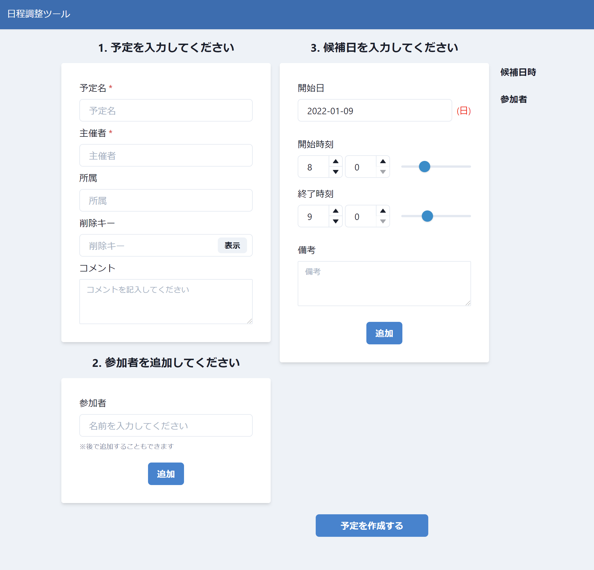

# 日程調整ツール v2.1

登録不要・URL共有で使える、結果を **CSV・ICS で持ち出せる** モダンな日程調整ツールです。



## 特徴

- **登録不要・無料**: 主催者も回答者もアカウント登録なし。URLを共有するだけ
- **結果を持ち出せる**: CSV（Excel互換・UTF-8 BOM付き）と ICS（Googleカレンダー / Outlook / Appleカレンダー）でエクスポート
- **作成後に編集できる**: 候補日の追加・削除、イベント情報の変更、日程確定・確定解除、イベント削除（編集キーで保護）
- **おすすめ日程**: ◯=2点・△=1点で自動集計し、最高スコアの候補に「おすすめ」バッジ
- **自分の回答を後から修正**: 回答した端末から編集可能
- **モダンUI / PWA**: スマホ最適化・ダークモード・ホーム画面に追加可能
- **SEO対応**: メタデータ / OGP / 構造化データ (JSON-LD) / sitemap / robots、イベントページは noindex

## 技術スタック

| 層 | 技術 |
|----|------|
| Backend | Python 3.12+, Django 5.2 LTS, Django REST Framework 3.18, drf-spectacular, Gunicorn, WhiteNoise |
| DB | PostgreSQL 15（ローカル開発は SQLite 可） |
| Frontend | Next.js 15 (App Router), React 19, TypeScript, Chakra UI v2, TanStack Query, Zustand, React Hook Form + Zod, react-day-picker |
| Test | Django TestCase + coverage / Vitest + Testing Library / Playwright |
| Deploy | Docker, Caddy（自動HTTPS）, GitHub Actions CI, Render Blueprint（代替） |

設計ドキュメントは [docs/](docs/00_index.md) を参照してください。

## ローカル開発

### 必要条件

- Python 3.12+（3.14 でも動作確認済み）
- Node.js 20.9+（推奨 22）

### バックエンド

```bash
python -m venv .venv
source .venv/bin/activate          # Windows: .venv\Scripts\activate
pip install -r requirements-dev.txt

cp api/.env.example api/.env       # DEBUG=True, SECRET_KEY を設定
cd api
python manage.py migrate
python manage.py runserver         # http://localhost:8000/api/docs/
```

### フロントエンド

```bash
cd front
cp .env.example .env.local         # 必要に応じて編集
npm install
npm run dev                        # http://localhost:3000
```

### Docker で一括起動

```bash
docker compose up --build          # db + api + front（開発サーバー）
```

## テスト

```bash
# バックエンド（69テスト / カバレッジ 95%）
cd api
python manage.py test schedule
coverage run --source=schedule manage.py test schedule && coverage report

# フロントエンド
cd front
npm run lint
npm run type-check
npm test                           # Vitest（49テスト / カバレッジ 92%）

# E2E（API と本番ビルドの Next.js を自動起動）
npm run build
npx playwright install chromium
E2E_PYTHON=../.venv/bin/python npx playwright test   # Windows は python.exe の絶対パスを指定
```

## デプロイ

本番デプロイ手順は **[docs/10_deployment.md](docs/10_deployment.md)** を参照してください。最短手順:

```bash
cp .env.production.example .env.production   # DOMAIN と各シークレットを設定
docker compose -f docker-compose.prod.yml --env-file .env.production up -d --build
```

Caddy が Let's Encrypt で HTTPS を自動設定し、`https://DOMAIN/api/*` を Django、それ以外を Next.js に振り分けます。

## API

開発サーバー起動後、以下でAPIドキュメントを確認できます。

- Swagger UI: http://localhost:8000/api/docs/
- ReDoc: http://localhost:8000/api/redoc/

| メソッド | エンドポイント | 説明 | 認証 |
|---------|---------------|------|------|
| POST | `/api/v1/schedules/` | イベント作成（編集キー未指定時は `_edit_key` を1回だけ返却） | なし |
| GET | `/api/v1/schedules/{uuid}/` | イベント詳細 | なし |
| PATCH / DELETE | `/api/v1/schedules/{uuid}/` | 更新 / 削除 | 編集キー |
| POST | `/api/v1/schedules/{uuid}/verify_edit_key/` | 編集キーの確認 | 編集キー |
| POST | `/api/v1/schedules/{uuid}/respond/` | 回答送信（`edit_token` 付きで更新） | なし |
| POST | `/api/v1/schedules/{uuid}/finalize/` | 日程確定（`candidate_id: null` で解除） | 編集キー |
| GET | `/api/v1/schedules/{uuid}/summary/` | 集計 + おすすめ | なし |
| GET | `/api/v1/schedules/{uuid}/export_csv/` | CSV出力 | なし |
| GET | `/api/v1/schedules/{uuid}/export_ics/` | ICS出力（`?candidate_id=`） | なし |
| POST / DELETE | `/api/v1/schedules/{uuid}/candidates/[{id}/]` | 候補日の追加 / 削除 | 編集キー |

編集キーは `X-Edit-Key` ヘッダー（またはリクエストボディの `edit_key`）で送信します。一覧API（`GET /api/v1/schedules/`）は情報漏洩防止のため提供していません（405）。

## ライセンス

MIT License
